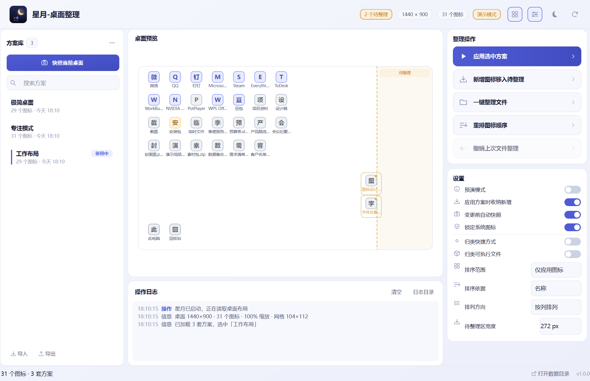
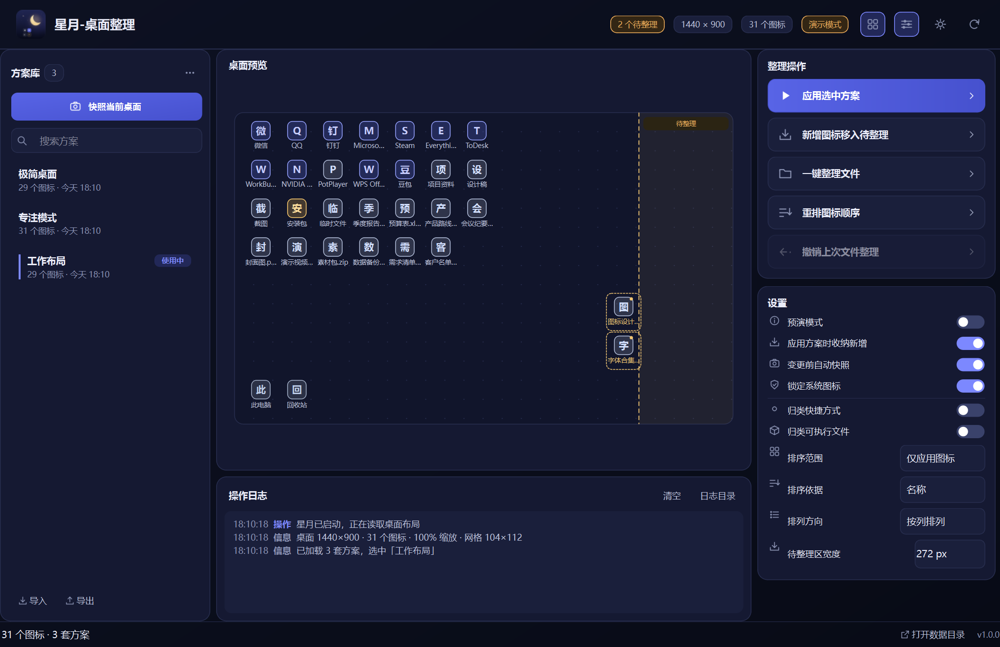
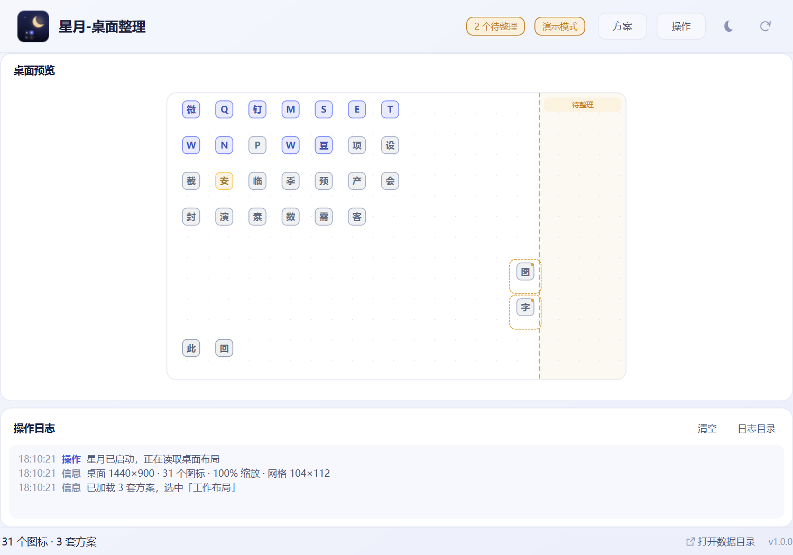
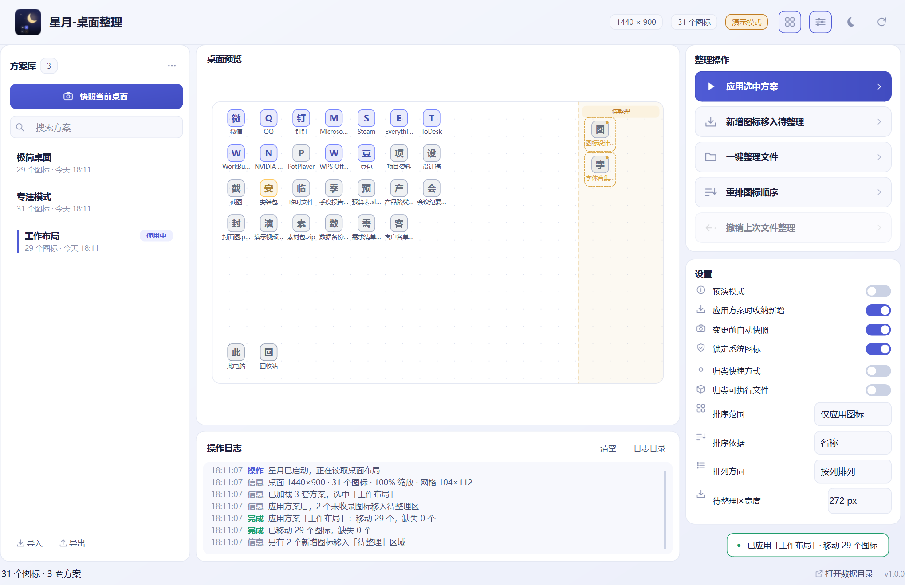
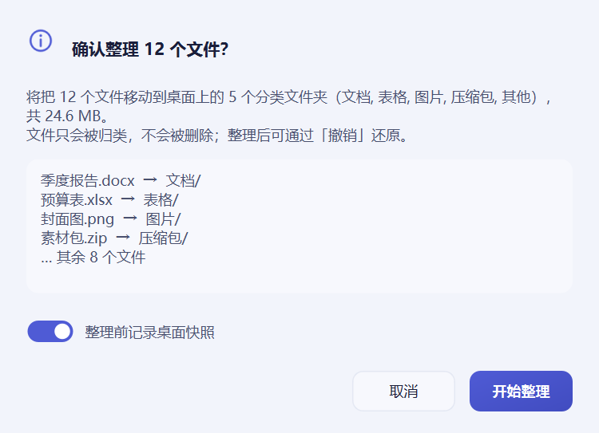
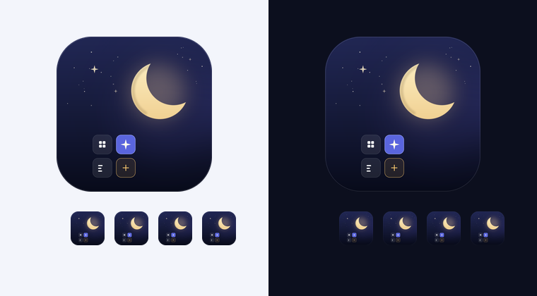

# 星月 · 桌面整理

[](https://github.com/Aojiaojiejie/xingyue-desktop/actions/workflows/ci.yml)
[](LICENSE)
[](#已知限制)

Windows 桌面图标布局管理工具。为当前桌面图标位置建立快照，一键恢复；支持多套布局方案、右侧「待整理」区、按文件类型自动归类，以及按规则重排图标。



## 功能

- **快照与恢复**：记录当前所有桌面图标的坐标，随时一键还原。
- **多套方案**：新建、重命名、复制、删除、导入、导出；点击方案即可预览，双击或点击「应用选中方案」生效。
- **待整理区**：自动识别不属于当前方案的图标，收纳到桌面右侧竖条区域；应用方案时也可自动收纳。
- **一键整理**：按类型把桌面文件归入「图片 / 文档 / 表格 / 演示 / 压缩包 / 安装包 / 音视频 / 代码 / 其他」文件夹。
- **图标排序**：按名称、类型或修改时间，按列或按行重排；可选择只排应用图标或全部图标。
- **撤销整理**：文件移动写入撤销记录，可一键还原。
- **安全机制**：变更前可自动快照，文件操作二次确认，系统图标默认锁定。
- **适配**：浅色 / 深色主题；分辨率变化时按比例缩放快照；窗口变窄时自动收起侧栏。

## 界面

| 深色主题 | 紧凑布局 |
| --- | --- |
|  |  |

三栏结构：左侧方案库，中间桌面预览与操作日志，右侧整理操作与设置。



整理文件前展示完整移动计划，确认后才执行：



## 应用图标



## 安装与卸载

安装程序按当前用户安装，不需要管理员权限；PowerShell 脚本可直接审阅。

### 1. 构建

```powershell
packaging\build.cmd
```

产物：`artifacts\星月-桌面整理.exe`。如果系统里有多个 Python，可显式指定：

```powershell
packaging\build.cmd -PythonExe "C:\Path\To\Python\python.exe"
```

### 2. 安装

双击 `installer\install.cmd`，或执行：

```powershell
installer\install.cmd
```

默认位置：

- 程序：`%LOCALAPPDATA%\Programs\XingYueDesktop`
- 开始菜单快捷方式：`%APPDATA%\Microsoft\Windows\Start Menu\Programs\星月-桌面整理.lnk`
- 用户数据：`%APPDATA%\XingYueDesktop`
- 卸载项：`HKCU\Software\Microsoft\Windows\CurrentVersion\Uninstall\XingYueDesktop`

需要桌面快捷方式时使用 `installer\install.cmd -DesktopShortcut`。安装参数与隔离测试方式见 [installer/README.md](installer/README.md)。

exe 未做代码签名，首次运行时 Windows SmartScreen 可能提示；选择“更多信息 → 仍要运行”即可。

### 3. 卸载

通过 Windows 设置 → 应用 → 已安装的应用卸载，或运行安装目录中的 `uninstall.cmd`。默认保留用户数据；需要一并删除时使用 `-PurgeData`。

### 便携运行

不安装也可以直接运行 `artifacts\星月-桌面整理.exe`；数据仍写入 `%APPDATA%\XingYueDesktop`。

## 使用

1. 启动程序，程序只读取桌面图标，不会自动修改。
2. 点击「快照当前桌面」，输入方案名，保存当前布局。
3. 自由拖动桌面图标后，选中方案并点击「应用选中方案」，图标回到快照位置。
4. 点击「新增图标移入待整理」，或开启「应用方案时收纳新增」，让新图标集中到右侧待整理区。
5. 点击「一键整理文件」，在确认框中查看移动计划后执行；需要先看计划可开启「预演模式」。
6. 误操作时点击「撤销上次文件整理」还原。

### 快捷键

| 快捷键 | 功能 |
| --- | --- |
| `Ctrl + N` | 快照当前桌面 |
| `Ctrl + 1…9` | 应用第 1…9 套方案 |
| `F5` / `Ctrl + R` | 重新读取桌面 |
| `Ctrl + Z` | 撤销上次文件整理 |
| `Ctrl + E` | 导出全部方案 |
| `Ctrl + I` | 导入方案 |

## 从源码开发

```powershell
python -m venv .venv
.\.venv\Scripts\Activate.ps1
pip install -r requirements-dev.txt
pip install -e .
```

启动方式（三种等价入口）：

```powershell
python main.py
python -m xingyue_desktop
xingyue-desktop
```

演示模式不读写真实桌面，适合调试界面：

```powershell
python main.py --demo
```

### 测试

```powershell
pytest
```

当前 14 项核心逻辑测试覆盖归类、待整理区排布、排序、坐标缩放、存储、快照恢复、整理与撤销，以及路径遍历防护。

### 构建与打包

```powershell
packaging\build.cmd            # 测试 + PyInstaller
packaging\build.cmd -SkipTests # 仅打包
python tools\make_icon.py      # 重新生成图标与文档预览
```

构建配置：

- `packaging\xingyue-desktop.spec`：PyInstaller 配置
- `config\version_info.txt`：Windows 文件版本资源
- `config\app_manifest.json`：安装程序/构建脚本使用的名称与版本

版本号需同时出现在 `config\app_manifest.json`、`config\version_info.txt`、`pyproject.toml` 与 `src\xingyue_desktop\core\models.py`；构建脚本会校验清单中的版本与代码常量是否一致。

## 项目结构

```text
.
├─ src/xingyue_desktop/     # 应用源码（包名：xingyue_desktop）
│  ├─ core/                 # 桌面读写、快照、整理算法、存储、服务层
│  ├─ ui/                   # 主题、图标、控件、主窗口、对话框
│  ├─ cli.py                # 命令行与启动逻辑
│  └─ __main__.py           # python -m xingyue_desktop
├─ resources/icons/         # 运行时图标（ico / png）
├─ config/                  # 版本资源与安装清单
├─ packaging/               # PyInstaller spec 与构建脚本
├─ installer/               # 安装 / 卸载脚本
├─ docs/                    # 架构、开发说明与界面截图
├─ tests/                   # 核心逻辑测试
├─ tools/                   # 图标生成、UI 检查脚本
├─ artifacts/               # 本地构建产物（git 忽略）
├─ main.py                  # 源码启动入口
├─ pyproject.toml           # 包元数据、依赖、pytest 配置
└─ requirements*.txt
```

## 数据与安全

- 数据目录：`%APPDATA%\XingYueDesktop`
  - `schemes/`：各方案的坐标快照
  - `journal.json`：文件整理撤销记录
  - `logs/`：按天记录的运行日志
- 只调整图标位置与文件归类，**不删除任何文件**。
- 文件移动前可自动创建快照；整理确认框会列出目标路径；执行后仍可撤销。
- 默认跳过快捷方式、可执行文件、隐藏/系统文件，避免误移动程序。
- 快照只记录坐标，不复制、不改写图标对应的文件。

### 已知限制

- 需要 Windows 10 / 11（64 位）与正在运行的资源管理器。
- 桌面开启「自动排列图标」时无法写入自定义位置；应用方案时程序会关闭该选项并在日志中提示。
- 「将图标与网格对齐」可能让坐标吸附到最近网格，恢复位置可能存在少量像素偏差。
- 更改系统图标大小或缩放比例后，网格间距变化，快照会按桌面尺寸等比缩放，但无法完全复刻原网格。
- 文件归类只处理当前用户桌面，不处理公共桌面（`C:\Users\Public\Desktop`）。
- 混合 DPI 的多显示器环境未做专项适配。

## 技术实现

- Python 3.13 + PySide6（Qt 6）
- 通过 Win32 `SysListView32` 消息读写桌面图标：`LVM_GETITEMTEXTW`、`LVM_GETITEMPOSITION`、`LVM_SETITEMPOSITION32`
- 跨进程读取使用 `VirtualAllocEx` / `ReadProcessMemory`，以 `SetProcessDpiAwarenessContext` 保持坐标与资源管理器一致
- 快照、设置、撤销记录均以 JSON 原子写入本地
- 纯函数整理算法，支持预演与单元测试

## 文档

- [架构说明](docs/ARCHITECTURE.md)
- [开发与发布](docs/DEVELOPMENT.md)
- [安装与卸载](installer/README.md)
- [贡献指南](CONTRIBUTING.md)

## 许可证

[MIT](LICENSE) © 2026 Aojiaojiejie

可自由使用、修改、分发与商用，保留版权声明即可。

## 版本

1.0.0
